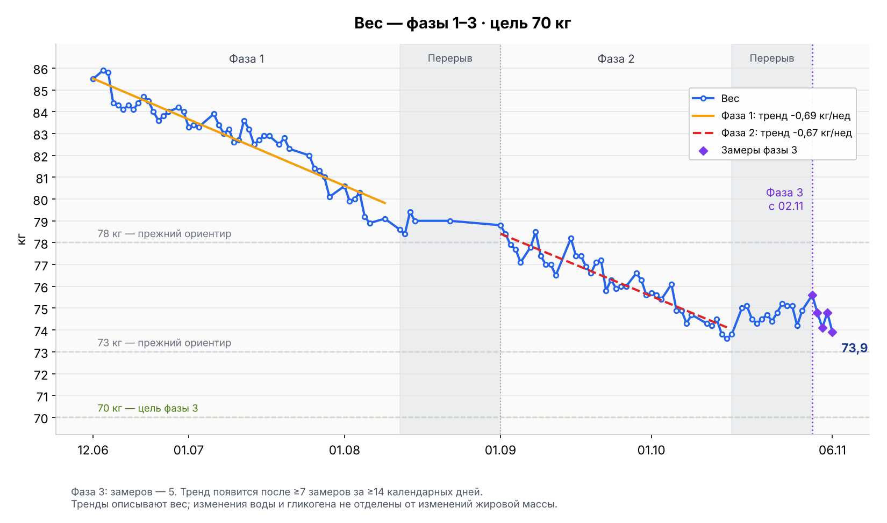
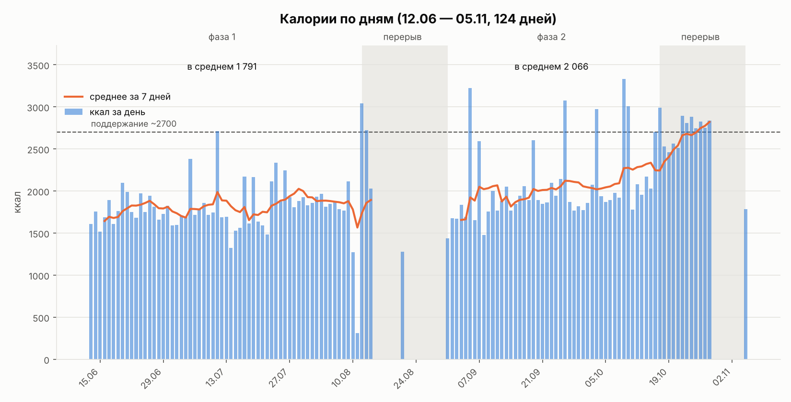

# Похудение: 85 → 70 кг

Фаза 3 со 2 ноября 2026 · обычный день 1900 ккал, суббота до 2500 ккал · белок 150 г

## Вес

Все замеры: [журнал веса](health/журнал-веса.md)

## Питание

Все дни с КБЖУ: [журнал питания](health/журнал-еды.md)

## Остальное

- [План и фазы](health/00-обзор.md) · [фаза 3](health/03-фаза-3.md)
- [Тренировки](health/тренировки.md)
- [Идеи меню](health/меню-идеи.md)
- [Отчёт для врача](health/отчёт-для-врача.md)
