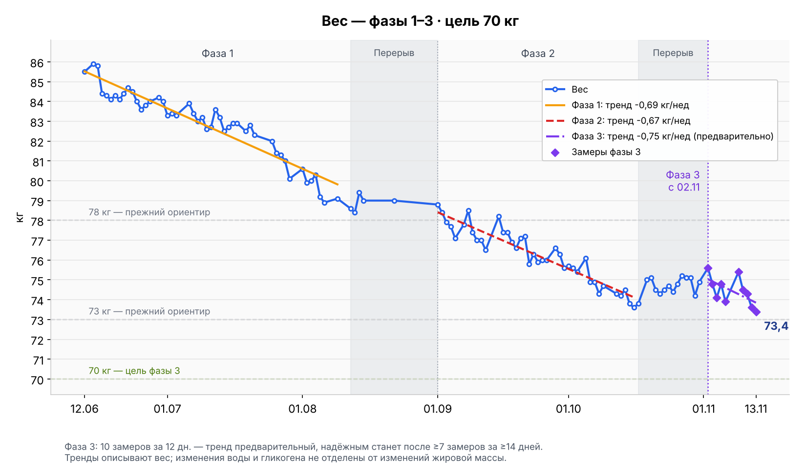

# Журнал веса

**Старт:** 12 июня 2026, ~85,3–85,5 кг (точного замера на старте не было; 85,0 в плане — округление) · **Цель:** 70,0 кг (конец ноября)

> Точный baseline зафиксируем по **среднему за 1-ю неделю** — он надёжнее любого одного утреннего замера.

## Как взвешиваться (из [00-обзор.md](00-обзор.md))

- **Каждое утро**, сразу после туалета, **до еды и воды**, в одном и том же (или без).
- Записывать каждый день, но **смотреть на среднее за неделю**, а не на отдельную цифру.
- Сравнивать **неделю с неделей**, не день с днём.
- **Дневные скачки ±1 кг — это вода/еда/соль, не жир.** Особенно после солёного (консервы, соевый соус) — соль задерживает воду на 1–2 дня.

## Замеры

| Дата | Вес | Заметка |
|---|---|---|
| 12 июня | ~85,3–85,5 кг | старт, оценка (точно не вешался; последний замер был ~85,5) |
| 14 июня | 85,9 кг | накануне солёная рыбная консерва → вода |
| 15 июня | 85,8 кг | замер 6:30; накануне сардина → соль/вода |
| 16 июня | 84,4 кг | резкий «whoosh» — вышла вода (несолёный лёгкий день) |
| 17 июня | 84,3 кг | |
| 18 июня | 84,1 кг | конец недели 1 |
| 19 июня | 84,3 кг | старт недели 2; горбуша накануне → вода (+0,2 ожидаемо) |
| 20 июня | 84,1 кг | вода ушла, вернулся к 84,1 |
| 21 июня | 84,4 кг | накануне квас + сухарики (сахар/соль) → вода |
| 22 июня | 84,7 кг | накануне соевый соус + сладкий чай → вода (выходные) |
| 23 июня | 84,5 кг | замер 6:40 (не 8:30); вода от выходных уходит |
| 24 июня | 84,0 кг | вода ушла — новый минимум |
| 25 июня | 83,6 кг | конец недели 2 — новый минимум |
| 26 июня | 83,8 кг | старт недели 3; после большой тренировки → вода в мышцах (+0,2 ожидаемо) |
| 27 июня | 84,0 кг | накануне том ям + паста-салат (соль/жир) → вода |
| 28 июня | — | взвешивание пропущено |
| 29 июня | 84,2 кг | замер 6:40; выходные (роллы/фастфуд/сахар/соль) → вода |
| 30 июня | 84,0 кг | утро натощак; вода от выходных уходит |
| 1 июля | 83,3 кг | 🔥 новый минимум — вода ушла, реальный прогресс |
| 2 июля | 83,4 кг | конец недели 3 |
| 3 июля | 83,3 кг | старт недели 4; держит новый минимум (скумбрия не задержала воду) |
| 4–5 июля | — | свои весы недоступны. Чужие весы (только между собой): сб 83,6 → вс 83,9. С основными НЕ сравнивать (другая калибровка); в график не вносим |
| 6 июля | 83,9 кг | свои весы; утро после чит-дня (вс) → вода от углеводов/гликогена. Реальную цифру мерить ср–чт |
| 7 июля | 83,4 кг | вода от чит-дня уходит (−0,5 за сутки), как и предсказано |
| 8 июля | 83,0 кг | 🔥 ср — показательный день; вода от чита ушла, **новый минимум** (был 83,3). Механизм «вода маскирует жир» подтвердился |
| 9 июля | 83,2 кг | чт — конец недели 4; +0,2 к минимуму — обычный дневной шум, не жир |
| 10 июля | 82,6 кг | 🔥 старт недели 5; **новый минимум** (был 83,0). Пробили 83 вниз впервые. И это после тренировочного дня с догоном по еде — дефицит работает даже с топливом |
| 11 июля | 82,7 кг | сб; +0,1 к минимуму — держит новый диапазон под 83, обычный дневной шум |
| 12 июля | 83,6 кг | вс; +0,9 после субботнего рефида (суши + соевый соус) → вода/гликоген, **не жир**. Ровно как предсказано. Реальную цифру мерить ср–чт |
| 13 июля | 83,2 кг | пн; вода от рефида уходит (−0,4 за сутки). Реальную цифру всё равно смотреть ср–чт |
| 14 июля | 82,5 кг | 🔥 вт; **новый минимум** (был 82,6) — вода от рефида ушла даже раньше прогноза (ждали ср–чт). Рефид-цикл отработал идеально: 82,7 → 83,6 → 83,2 → 82,5 |
| 15 июля | 82,7 кг | ср; +0,2 — вода в мышцах после первой тренировки с весом (+6,2 кг, большой объём + полные ноги). Ожидаемо, не жир |
| 16 июля | 82,9 кг | чт; конец недели 5. Вода на восстановление мышц — пик отёка 24–72 ч после новой нагрузки (первая тренировка с весом + полные ноги). Еда оба дня чистая (~1325/~1527) — жиру взяться неоткуда |
| 17 июля | 82,9 кг | пт; старт недели 6; держит 82,9 — мышечный отёк ещё не сошёл, плато шума |
| 18 июля | — | взвешивание пропущено |
| 19 июля | 82,5 кг | вс; отёк от первых тренировок с весом сошёл (82,9 → 82,5) — вернулся на минимум, ровно на линии тренда |
| 20 июля | 82,8 кг | пн; +0,3 после вечерней чиабатты + холодца (соль + углеводы → вода), ожидаемо. Реальная цифра — ср–чт |
| 21 июля | 82,3 кг | 🔥 вт; **новый минимум** (был 82,5) — на день раньше контрольного окна. −0,5 за сутки: вода чиабатты вышла + открылся жир, который она прятала |
| 22 июля | — | свои весы: пропущено. Чужие весы показали 81,0 — в график не вносим (другая калибровка, сравнивать нельзя), но как независимый сигнал тренда — приятно |
| 23–24 июля | — | без своих весов (поездка) |
| 25 июля | 82,0 кг | 🔥 сб; **новый минимум** (был 82,3) — и это после вчерашней рёберной (стейк+рёбра) и дня солёных огурцов. Ожидали +0,5 воды, а получили минимум — реальный жир ниже, чем видно |
| 26 июля | 81,4 кг | 🔥🔥 вс; **новый минимум** (был 82,0) — **пробили 82 вниз**, первый раз в диапазоне 81,x на своих весах. −0,6 за сутки: вода рёберной вышла + чистая суббота (~1877/170). Чужие весы 22.07 (81,0) не соврали про тренд. Сегодня рефид — завтра-послезавтра ждать +0,5–0,9 воды, не пугаться |
| 27 июля | 81,3 кг | 🔥 пн; **новый минимум** (был 81,4) — наутро после рефида, где ждали +0,5–0,9 воды. Рефид вышел чистым (~2245/206: курица, гречка, ягоды, фрукты — почти без соли и быстрых углеводов), задерживать воду было нечему |
| 28 июля | 81,0 кг | 🔥 вт; **новый минимум** (был 81,3) — **третий минимум подряд** (81,4 → 81,3 → 81,0). Ровно та цифра, что показали чужие весы 22.07. До психологической отметки 80,x — один шаг |
| 29 июля | 80,1 кг | 🔥🔥 ср; **новый минимум** (был 81,0) — **пробили 81**, −0,9 за сутки, четвёртый минимум подряд. За 4 дня 82,0 → 80,1 (−1,9): вышла вся вода рёберной/поездки + жир под ней. Темп недели выше нормы — следить за самочувствием (сила пока растёт: рекорды 28.07) |
| 30 июля | — | взвешивание пропущено (забыл). С утра чит ВиТ — завтра ждать +0,5–1,0 воды от соли/углеводов, не пугаться |
| 31 июля | — | взвешивание пропущено |
| 1 августа | 80,6 кг | сб; +0,5 к минимуму (80,1) после двух дней с ВиТ (соль + углеводы → вода) — ровно предсказанный отскок, не жир. Реальную цифру смотреть вс–пн |
| 2 августа | 79,9 кг | 🔥🔥 вс; **новый минимум** (был 80,1) — **ПРОБИЛИ 80**, первая цифра 79,x. Вода от ВиТ вышла за сутки (80,6 → 79,9) после чистой субботы (~1857/155). −5,6 кг от старта |
| 3 августа | 80,0 кг | пн; +0,1 к минимуму — дневной шум, держит диапазон под 80,1. Вчера умеренный рефид (~1932/132) — вода не прилипла |
| 4 августа | 80,3 кг | вт; +0,3 после вчерашнего доширака (соляная бомба → вода) — предсказано в момент записи еды, не жир. День был в дефиците (~1965). Реальная цифра — ср–чт |
| 5 августа | 79,2 кг | 🔥🔥 ср; **новый минимум** (был 79,9) — **−1,1 за сутки**: соляная вода доширака вышла, под ней открылся жир. Накануне ~1812/186 (белковый топ-день). **До финиша фазы 1 (78,0) осталось 1,2 кг** |
| 6 августа | 78,9 кг | 🔥🔥 чт; **новый минимум** (был 79,2) — **пробили 79**. За 12 дней 82,0 → 78,9 (−3,1): ~1,3 кг жир по дефициту + ~1,8 кг вода, копившаяся в июле (тренировочный отёк + соль), вышла разом. До 78,0 — 0,9 кг |
| 7 августа | — | взвешивание пропущено |
| 8 августа | — | свои весы: пропущено (поздний подъём). Чужие весы в 9:30 — 78,4; в график не вносим (другая калибровка), но как сигнал тренда — согласуется с 78,9 на своих |
| 9 августа | 79,1 кг | вс; +0,2 к минимуму (78,9) после вчерашних чипсов 93 г (соль → вода) — предсказано заранее, не жир. Плюс отёк ног после возвращения выпадов (22 дня перерыва). Реальная цифра — вт–ср |
| 10–11 августа | — | дорога (сутки в автобусе), взвешиваний нет |
| 12 августа | 78,6 кг | 🔥 вт; **новый минимум** (был 78,9) — и это сразу после дороги, где ждали +0,5–1,0 отёка от суток сидя и соли. Значит реальный вес ещё ниже. **До финиша фазы 1 (78,0) — 0,6 кг** |
| 13 августа | 78,4 кг | 🔥 чт; **новый минимум** (был 78,6) — наутро после дня в ~3039 ккал (профицит ~340). Отдых, оценки на глаз. **До финиша фазы 1 — 0,4 кг** |
| 14 августа | 79,4 кг | пт; +1,0 после вечернего шашлыка ~350 г — соль маринада тянет воду, классика. День был ровно на поддержке (~2725), жиру взяться неоткуда. Реальная цифра — через 1–2 дня |
| 15 августа | 79,0 кг | сб; −0,4 за сутки — вода от шашлыка уходит по расписанию. Накануне ~2030 ккал (дефицит ~700–800 при 17–22к шагов). До минимума (78,4) — 0,6 |
| 16–21 августа | — | 🏖 отдых, замеров на своих весах нет. По памяти колебалось 79,0–80,0 (гликоген восстановился после низкоуглеводного периода + соль). 20–21.08 — сутки в автобусе |
| 22 августа | 79,0 кг | пт; возвращение домой. **Ровно та же цифра, что 15.08** — за неделю отдыха ноль изменений при питании на глаз, 4–5 тренировках и 17–22к шагов. Минимум остаётся 78,4 (13.08) |
| 23–30 августа | — | ✈️ поездка в другую страну, взвешиваний нет. Питание около поддержки — **diet break выполнен** (~12–31.08, около трёх недель) |
| 31 августа | — | взвешивание пропущено (день возвращения, цифра после дороги «грязная») |
| 1 сентября | 78,8 кг | 🚀 пн; **СТАРТ ФАЗЫ 2**. После трёх недель вне режима — 78,8: всего +0,4 к абсолютному минимуму (78,4) и **ниже** 79,0 от 22.08. И это наутро после консервы (соль). До цели фазы 1 (78,0) — 0,8 кг, пройдём по ходу фазы 2 |
| 2 сентября | 78,4 кг | вт; **повтор абсолютного минимума** (78,4 от 13.08) — за сутки −0,4. Замер по протоколу (после туалета, натощак — как все предыдущие). До цели фазы 1 (78,0) — 0,4 кг |
| 3 сентября | 77,9 кг | 🎉🎉 ср; **ЦЕЛЬ ФАЗЫ 1 (78,0) ВЗЯТА** — первая цифра 77,x, новый абсолютный минимум (был 78,4). **−7,6 кг от старта** (85,5 → 77,9) за 12 недель. Взято уже внутри фазы 2, как и планировали |
| 4 сентября | 77,7 кг | 🔥 чт; **новый минимум** (был 77,9) — второй день подряд ниже цели фазы 1. **−7,8 кг от старта**. До цели фазы 2 (73,0) — 4,7 кг |
| 5 сентября | 77,1 кг | 🔥 пт; **новый минимум** (был 77,7). За 4 дня 78,8 → 77,1 (−1,7): по дефициту ~0,4 кг жира, остальные **~1,3 кг — вода и гликоген**, набранные за отпуск и теперь уходящие (обратный whoosh после диет-брейка). Весы проверены сменой батарей — показания те же |
| 6 сентября | — | взвешивание пропущено сознательно: накануне вечером заказ в ВиТ (~2110 ккал), ожидается +0,8–1,5 воды от соли и быстрых углеводов. Реальную цифру смотреть пн–вт |
| 7 сентября | 77,8 кг | пн; через ~36 часов после ВиТ: **+0,7 к минимуму 77,1** — вода от соли и быстрых углеводов, в нижней части ожидаемого диапазона (+0,8–1,5). Вчера ~1650 ккал и тренировка-рекорд. Честная цифра — вт–ср |
| 8 сентября | 78,5 кг | вт; **+0,7 за сутки** после солёного дня (соевый соус, ветчина, сыр, майонез) и 2592 ккал — вода и объём еды в ЖКТ, не жир (для +0,7 жира нужно +5400 ккал сверх расхода). К минимуму 77,1 = +1,4. Честную цифру смотреть чт–пт при чистых днях |
| 9 сентября | 77,4 кг | ср; **−1,1 за сутки** — солёная вода 7.09 ушла за один чистый день (1479 ккал, обычная соль), как и после доширака/шашлыка. +0,3 к минимуму 77,1, в четверг–пятницу реальный шанс на новый минимум |
| 10 сентября | 77,0 кг | 🔥 чт; **новый минимум** (был 77,1 от 5.09). Вся вода после ВиТ и офиса ушла за два чистых дня (1479 и 1755 ккал). −8,5 кг от старта, до цели фазы 2 (73) — 4,0 |
| 11 сентября | 77,0 кг | пт; **повтор минимума** — вес замер. Накануне солёный обед в HSE Cafe (майонез, сыр) и день на 2000 ккал, дефицит ~450 вместо обычных 700–900. Ни роста, ни падения |
| 12 сентября | 76,5 кг | 🔥 сб; **новый минимум** (был 77,0) — первая цифра 76,x. **Ровно −9,0 кг от старта** (85,5 → 76,5 за 13 недель). Накануне чистый день: столовая на пару, 1767 ккал / 143 г белка. До цели фазы 2 (73) — 3,5 |
| 13 сентября | — | взвешивание пропущено. Накануне колики и дважды объёмный стул — кишечник опорожнён, цифра была бы занижена на 0,3–0,6 кг не за счёт жира |
| 14 сентября | — | взвешивание пропущено второй день подряд. Последняя цифра — 76,5 от 12.09 |
| 15 сентября | 78,2 кг | вт; **+1,7 к 76,5 от 12.09 — это не жир**. За три дня съедено 5706 при расходе ~7350, дефицит ~1650 = −0,2 кг жира. Складывается из: кишечник (взвешивание 12.09 было ДО коликов, то есть 76,5 — честная цифра; после опорожнения он наполнился заново и объёмом выше обычного — 13.09 вечером 556 г цветной капусты + 350 г тушёных овощей, 14.09 вечером ~900 г овощей) +0,4–0,8; две короткие ночи с подъёмом в 4:00 → кортизол держит воду +0,5–1,0; переезд и дорожная соль +0,3–0,5. Реальную картину смотреть в чт–пт |
| 16 сентября | 77,4 кг | ср; **−0,8 за сутки** — вода после переезда и коротких ночей пошла обратно ровно по прогнозу. Накануне чистый день 1846 ккал / 143 г белка, нормальный сон. Пятый откат за фазу: 78,5→77,4 (8–9.09), теперь 78,2→77,4. До минимума 76,5 осталось 0,9 |
| 17 сентября | 77,4 кг | чт; **повтор 77,4**. Накануне тренировка на 240 повторений после 4 дней без нагрузки — мышцы держат воду на восстановление. Еда 1946 ккал / 145 г белка, дефицит ~850. Такой замер после возобновления тренировок был и 14.08 (79,4 после новой нагрузки) |
| 18 сентября | 76,9 кг | пт; **−0,5 за сутки** — отёк после двух тренировок подряд (16 и 17.09) ушёл. Вторая по величине цифра за всё время, ниже только 76,5 от 12.09. −8,6 кг от старта. Фото-сравнение с 5.08 (79,2): минус почти весь пришёлся на живот и талию |
| 19 сентября | 76,6 кг | сб; **−0,3 за сутки**, вторая цифра за всё время — до абсолютного минимума 76,5 осталось 0,1. Накануне 1892 ккал / 178 г белка, день без тренировки. −8,9 кг от старта, до цели фазы 2 (73) — 3,6 |
| 20 сентября | 77,1 кг | вс; **+0,5** после дня на 2603 ккал (мороженое ВиТ 374, ролл с креветками 397, хлеб 174 г). Прогноз был 77,5–78 — вышло мягче, потому что добавка ушла в белок и ягоды, а не в жирное. Вода от соли и углеводов, откат ждать вт–ср |
| 21 сентября | 77,2 кг | пн; **+0,1** — второй день после субботнего чита, вода ещё держится. Накануне чистый день 1892 ккал / 182 г белка, дефицит ~560. Откат обычно приходит на 2–3-й день, значит вт–ср |
| 22 сентября | 75,8 кг | 🔥 вт; **НОВЫЙ АБСОЛЮТНЫЙ МИНИМУМ**, первая цифра 75,x (было 76,5 от 12.09). **−1,4 за сутки** — повторение рекордного суточного падения за всю историю (15→16.06). Сложилось: субботняя вода после чита ушла (третий день, по графику) + тренировка на 373 повторения выжгла гликоген, а он тянет 3 г воды на грамм + 100 выпадов после 15 дней + **накануне объёмный стул (−0,3…0,6 кг содержимого кишечника)**. Дефицит накануне ~980 объясняет только ~130 г, остальное вода. **−9,7 кг от старта, до цели фазы 2 (73) — 2,8**. Прогноз был 76,9–77,4 — не сбылся, Андрей оказался прав. Цифра почти наверняка с перелётом: кишечник наполнится обратно, гликоген вернётся — честная база ближе к 76,3–76,6 |
| 23 сентября | 76,3 кг | ср; **+0,5** к вчерашним 75,8 — кишечник и гликоген вернулись, прогноз «честная база 76,3–76,6» сбылся. Это вторая цифра за всё время после 75,8 и первая «честная» ниже 76,5. −9,2 кг от старта, до цели фазы 2 (73) — 3,3 |
| 24 сентября | 75,9 кг | чт; **−0,4 за сутки**. Вторая цифра за всё время после 75,8, но вчерашние 75,8 были провалом, а эта — после обычного дня: 2097 ккал, тренировка с рекордом брусьев 38, лёгкая простуда. То есть реальная база сдвинулась к ~76. −9,6 кг от старта, до цели фазы 2 (73) — 2,9 |
| 25 сентября | 76,0 кг | пт; **+0,1** — стоит у 76, вторую неделю подряд база держится. Накануне 1941 ккал / 143 г белка, без тренировки. −9,5 кг от старта, до цели фазы 2 (73) — 3,0 |
| 26 сентября | 76,0 кг | сб; **повтор 76,0** — четвёртый день у 76 (76,3 / 75,9 / 76,0 / 76,0). Накануне 2142 ккал без тренировки, дефицит ~300, так что стоять на месте — ожидаемо. Вечером 25.09 был сильный голод, обсуждали рефиды и сдвиг еды на вечер. −9,5 кг от старта, до 73 — 3,0 |
| 27 сентября | — | взвешивание пропущено |
| 28 сентября | 76,6 кг | пн; **+0,6** к 76,0 от 26.09. Между ними рефид на 3074 ккал (ВиТ, булочка, пита) и 27.09 банка маринованных огурцов вместе с рассолом (~4–5 г соли). Прогноз был +0,7–1,2 — вышло даже меньше. Это вода и гликоген, откат ждать вт–ср |
| 29 сентября | 76,3 кг | вт; **−0,3** — вода после рефида (26.09) и рассола (27.09) уходит по графику. Накануне 1770 ккал / 146 г белка, из них ~440 ккал в растительных напитках. −9,2 кг от старта, до 73 — 3,3 |
| 30 сентября | 75,6 кг | 🔥 ср; **новый абсолютный минимум** (было 75,8 от 22.09). −0,7 за сутки. Накануне тренировка на 289 повторений с четырьмя рекордами и день 1817 ккал / 159 г белка — часть минуса это выжженный гликоген, как 22.09, так что завтра возможен отскок к ~76. **Итог сентября: 78,8 (1.09) → 75,6 = −3,2 кг за месяц.** −9,9 кг от старта, до 73 — 2,6 |
| 1 октября | 75,7 кг | чт; **+0,1** — небольшой отскок после резкого −0,7, точно по прогнозу (~75,8). Накануне 1775 ккал / 158 г белка, без тренировки. Вторая цифра за всё время. Среднее за 25.09–1.10 (6 замеров) — 76,0. −9,8 кг от старта, до 73 — 2,7 |
| 2 октября | 75,6 кг | 🔥 пт; **−0,1**, повтор абсолютного минимума. Накануне 1858 ккал / 158 г белка, без тренировки, с булочкой на 416 ккал — ждал +0,2–0,4 воды от углеводов, не случилось. Три замера подряд у 75,6–75,7: база сдвинулась. Среднее за 26.09–2.10 (6 замеров) — 75,97. −9,9 кг от старта, до 73 — 2,6 |
| 3 октября | 75,4 кг | 🔥 сб; **новый абсолютный минимум**, −0,2. ⚠️ Взвешивание в 8:50 вместо обычных 7:00 — за лишние ~2 часа натощак уходит ~0,1 кг с дыханием, так что «честная» цифра ~75,5. Накануне 2076 ккал / 160 г белка, без тренировки. Среднее за 27.09–3.10 (6 замеров) — 75,87. −10,1 кг от старта — **минус 10 кг пройден**, до 73 — 2,4 |
| 4 октября | — | взвешивание пропущено (наутро после рефида 2971 ккал) |
| 5 октября | 76,1 кг | пн; **+0,7** к 75,4 (3.10, взвешивание в 8:50 — к 7:00 было бы ~75,5, так что реально +0,6). Между ними рефид 2971 ккал (роллы с соевым соусом, две питы — ~330 г углеводов и много соли) и тяжёлая тренировка с весом 4.10. Прогноз после рефида был +0,5–1,0 — попали. Это гликоген и вода, откат ждать вт–ср. Среднее за 29.09–5.10 (6 замеров) — 75,78. −9,4 кг от старта, до 73 — 3,1 |
| 6 октября | 74,9 кг | 🔥 вт; **новый абсолютный минимум, впервые ниже 75** (было 75,4 от 3.10). **−1,2 за сутки** — ушла вода после рефида 3.10 и тренировки 4.10, плюс день 1871 ккал, много фруктов, мало соли. Прогноз был 75,5–75,8 — вышло ниже. Среднее за 30.09–6.10 (6 замеров) — 75,55. **−10,6 кг от старта**, до 73 — 1,9 |
| 7 октября | 74,9 кг | 🔥 ср; **повтор минимума**. Ждал отскок к 75,1–75,3 после резкого −1,2 — его не было, значит 74,9 — честная база, а не провал. Накануне 1892 ккал / 139 г белка, без тренировки. Среднее за 1–7.10 (6 замеров) — 75,43. −10,6 кг от старта, до 73 — 1,9 |
| 8 октября | 74,3 кг | 🔥 чт; **новый абсолютный минимум**, −0,6. Перевешивался несколько раз, вынимал и вставлял батарейки — показания стабильные. Накануне 1976 ккал / 199 г белка. Похоже на «whoosh» после двух дней на 74,9. Среднее за 2–8.10 (6 замеров) — 75,2. **−11,2 кг от старта**, до 73 — 1,3 |
| 9 октября | 74,7 кг | пт; **+0,4** — отскок после провала 74,3, прогноз был 74,5–74,7. Накануне 1921 ккал / 134 г белка. Среднее за 3–9.10 (6 замеров) — 75,05. −10,8 кг от старта, до 73 — 1,7 |
| 10 октября | — | взвешивание пропущено (наутро после паба: ~3332 ккал, карбонара + 3 пива) |
| 11 октября | — | взвешивание пропущено (после встречи с другом 10.10, ~3005 ккал) |
| 12 октября | 74,3 кг | 🔥 пн; **повтор минимума** (как 8.10). После выходных на ~3332 (паб) и ~3005 (встреча) ждал 75,5–76 — прогноз не сбылся: вода не задержалась, воскресенье 1780 ккал / 187 г белка. Среднее за 6–12.10 (5 замеров) — 74,62. −11,2 кг от старта, до 73 — 1,3 |
| 13 октября | 74,2 кг | 🔥 вт; **новый абсолютный минимум** (было 74,3). Накануне тренировка с весом +10 и 2080 ккал / 170 г белка. Среднее за 7–13.10 (5 замеров) — 74,48. **−11,3 кг от старта**, до 73 — 1,2 |
| 14 октября | 74,5 кг | ср; +0,3 к минимуму — обычные колебания. Накануне 1957 ккал / 173 г белка, без тренировки. Среднее за 8–14.10 (5 замеров) — 74,4. −11,0 кг от старта, до 73 — 1,5 |
| 15 октября | 73,8 кг | 🔥 чт; **новый абсолютный минимум**, впервые ниже 74. −0,7 за сутки, хотя накануне было ~2169 ккал (вечерний голод). Среднее за 9–15.10 (5 замеров) — 74,3. **−11,7 кг от старта**, до 73 — 0,8 |
| 16 октября | 73,6 кг | 🔥 пт; **новый абсолютный минимум**, −0,2. Накануне тренировка с четырьмя рекордами и 2029 ккал / 185 г белка. Среднее за 10–16.10 (5 замеров) — 74,08. **−11,9 кг от старта**, до 73 — 0,6 |
| 17 октября | 73,8 кг | сб; **☕ перерыв, день 1.** ⚠️ Взвешивание около 10:00, а не утром как обычно. +0,2 после дня на ~2700 (16.10) — еда в кишечнике и вода, ожидаемо. Фаза 2 закрыта на 73,6. Среднее за 11–17.10 (5 замеров) — 73,98. Дальше в перерыве ждём +1–1,5 кг воды и гликогена за первую неделю |
| 18 октября | — | взвешивание пропущено |
| 19 октября | 75,0 кг | пн; **☕ перерыв, день 3.** +1,2 к 73,8 (17.10) за два дня на ~2989 и ~2530 ккал — гликоген и вода, ровно по прогнозу (+1–1,5 за первую неделю). Взвешивание в 7:10, а 17.10 было около 10:00 — к утру разница ~0,1–0,2 в пользу сегодняшнего, то есть реально прибавка ~1,0–1,1 |
| 20 октября | 75,1 кг | вт; **☕ перерыв, день 4.** +0,1 — вес встаёт на плато ~75 после первичной прибавки воды и гликогена. Накануне 2460 ккал (Б 192 / Ж 71 / У 261). Так и должно быть на поддержании |
| 21 октября | 74,5 кг | ср; **☕ перерыв, день 5.** −0,6 на поддержании: накануне 2561 ккал и тяжёлая тренировка (+15 кг, рекорд тоннажа). Подтверждает, что реальное поддержание ~2700+, а не 2500. Среднее за 17–21.10 (3 замера) — 74,87 |
| 22 октября | 74,3 кг | чт; **☕ перерыв, день 6.** −0,2 после 2512 ккал. Второй день подряд вниз на ~2500: 75,0 → 75,1 → 74,5 → 74,3. Значит, реальное поддержание выше 2500 — **поднимаем перерыв до 2700–2800** |
| 23 октября | 74,5 кг | пт; **☕ перерыв, день 7.** +0,2 после первого дня на 2895 ккал с плотным поздним ужином (лепёшка + щи) — вода и соль. Неделя перерыва: 73,8 → 75,0 → 75,1 → 74,5 → 74,3 → 74,5. Среднее за 19–23.10 (5 замеров) — 74,68. −11,0 кг от старта |
| 24 октября | 74,7 кг | сб; **☕ перерыв, день 8.** +0,2 после ~2810 ккал с плотным поздним ужином (лаваш 220 г + пита 160 г). Неделя 18–24.10: 75,0 → 75,1 → 74,5 → 74,3 → 74,5 → 74,7, среднее (6 замеров) — 74,68. Вес стоит на месте — поддержание ~2700–2800 подтверждается. −10,8 кг от старта |
| 25 октября | 74,4 кг | вс; **☕ перерыв, день 9.** −0,3 после ~2880 ккал. Неделя 19–25.10: 75,0 → 75,1 → 74,5 → 74,3 → 74,5 → 74,7 → 74,4, среднее (7 замеров) — 74,64. На 2700–2900 вес стоит/чуть снижается — поддержание ~2800. −11,1 кг от старта |
| 26 октября | 74,8 кг | пн; **☕ перерыв, день 10.** +0,4 после ~2746 ккал: шаурма (соль) + тренировка накануне (задержка воды в мышцах). Неделя 20–26.10: 75,1 → 74,5 → 74,3 → 74,5 → 74,7 → 74,4 → 74,8, среднее (7 замеров) — 74,61 (неделей ранее 74,64). Вес ровный. −10,7 кг от старта |
| 27 октября | 75,2 кг | вт; **☕ перерыв, день 11.** +0,4 после ~2826 ккал: много хлеба (лаваш + пита ~410 г) и сыр вечером — соль и вода. Неделя 21–27.10: 74,5 → 74,3 → 74,5 → 74,7 → 74,4 → 74,8 → 75,2, среднее (7 замеров) — 74,63 (неделей ранее 74,61). Среднее стоит — поддержание ~2800 подтверждено, скачки дня — вода. −10,3 кг от старта |
| 28 октября | 75,1 кг | ср; **☕ перерыв, день 12.** −0,1 после ~2751 ккал и первой тренировки в зале. Неделя 22–28.10: 74,3 → 74,5 → 74,7 → 74,4 → 74,8 → 75,2 → 75,1, среднее (7 замеров) — 74,71 (неделей ранее 74,63). Лёгкий дрейф вверх (+0,1/нед) — в пределах шума; часть — вода от хлеба/соли и новой нагрузки в зале. Если среднее продолжит расти >0,3/нед — вернуть 2600–2700. −10,4 кг от старта |
| 29 октября | 75,1 кг | чт; **☕ перерыв, день 13.** 0 после ~2839 ккал. Неделя 23–29.10: 74,5 → 74,7 → 74,4 → 74,8 → 75,2 → 75,1 → 75,1, среднее (7 замеров) — **74,83** (неделями ранее 74,63 → 74,71). Рост ~+0,1/нед при среднем ~2780 ккал → поддержание ~2650–2700. Часть прироста — вода от старта зала. **Цель снижена до 2600–2700** до конца перерыва. −10,4 кг от старта |
| 30 октября | 74,2 кг | пт; **☕ перерыв, день 14.** −0,9 кг к предыдущему замеру; −11,3 кг от стартовой оценки 85,5 кг |
| 31 октября | 74,9 кг | сб; **☕ перерыв, день 15.** +0,7 кг к предыдущему замеру. Среднее за 25–31.10 (7 замеров) — **74,81 кг**. −10,6 кг от стартовой оценки 85,5 кг |
| 2 ноября | 75,6 кг | пн; после чит-дня с ориентиром 3500 ккал (в журнале за 01.11 учтено ~3578 ккал, оценка шаурмы неточная). +0,7 кг к предыдущему замеру 31.10; −9,9 кг от стартовой оценки 85,5 кг |
| 3 ноября | 74,8 кг | вт; **фаза 3, день 2**. −0,8 кг к предыдущему замеру 02.11; −10,7 кг от стартовой оценки 85,5 кг |
| 4 ноября | 74,1 кг | ср; **фаза 3, день 3**. −0,7 кг к предыдущему замеру 03.11; −11,4 кг от стартовой оценки 85,5 кг |
| 5 ноября | 74,8 кг | чт; **фаза 3, день 4**. +0,7 кг к предыдущему замеру 04.11; −10,7 кг от стартовой оценки 85,5 кг |
| 6 ноября | 73,9 кг | пт; **фаза 3, день 5**. −0,9 кг к предыдущему замеру 05.11; −11,6 кг от стартовой оценки 85,5 кг; −1,7 кг от старта фазы 3 (75,6 кг, 02.11) |
| 9 ноября | 75,4 кг | пн; **фаза 3, день 8**. +1,5 кг к предыдущему замеру 06.11 (07–08.11 взвешиваний не было); −0,2 кг от старта фазы 3 (75,6 кг, 02.11); −10,1 кг от стартовой оценки 85,5 кг. Скачок после субботы с ~2470 ккал (фастфуд: солёное, соусы) и воскресенья с ~0,8 кг фруктов и ~0,5 кг овощей — вода, гликоген и содержимое ЖКТ; жиром быть не может: суббота ниже поддержания ~2700 ккал. Среднее первой недели фазы 3 (02–06.11, 5 замеров) — 74,64 кг |
| 10 ноября | 74,5 кг | вт; **фаза 3, день 9**. −0,9 кг к предыдущему замеру 09.11 — вода после субботнего фастфуда уходит; −1,1 кг от старта фазы 3 (75,6 кг, 02.11); −11,0 кг от стартовой оценки 85,5 кг |
| 11 ноября | 74,3 кг | ср; **фаза 3, день 10**. −0,2 кг к предыдущему замеру 10.11; −1,3 кг от старта фазы 3 (75,6 кг, 02.11); −11,2 кг от стартовой оценки 85,5 кг |
| 12 ноября | 73,6 кг | чт; **фаза 3, день 11**. −0,7 кг к предыдущему замеру 11.11, несмотря на ~2449 ккал накануне; новый минимум фазы 3 (прежний — 73,9 06.11); −2,0 кг от старта фазы 3 (75,6 кг, 02.11); −11,9 кг от стартовой оценки 85,5 кг |
| 13 ноября | 73,4 кг | пт; **фаза 3, день 12**. −0,2 кг к предыдущему замеру 12.11; новый минимум фазы 3; −2,2 кг от старта фазы 3 (75,6 кг, 02.11); −12,1 кг от стартовой оценки 85,5 кг |
| 7 ноября | — | сб; **фаза 3, день 6**. Пользователь забыл взвеситься; замер пропущен |

### График

> График — PNG, генерируется скриптом [`plot_weight.py`](plot_weight.py) из данных [`weight_data.csv`](weight_data.csv).
> Тренды считаются отдельно: фаза 1 — до 12.08; фаза 2 — 01.09–16.10; фаза 3 — со 02.11. Перерывы 12–31.08 и 17.10–01.11 выделены серым и исключены из трендов.
> Линия тренда появляется после минимум 7 замеров за 14 календарных дней включительно. Она описывает изменение веса, включая воду и гликоген, и не экстраполируется до цели. Текущая цель фазы 3 — 70 кг.
> Чтобы добавить замер: дописать строку в CSV (`date,weight,note`) и запустить `python3 plot_weight.py`.
> Проще — продиктовать вес мне: обновлю CSV, таблицу и перерисую картинку.

## Среднее по неделям

| Неделя | Период | Среднее | Δ к прошлой |
|---|---|---|---|
| 1 | 12–18 июня | ~84,9 кг (по замерам 14–18; 12–13 без точного веса) | — (база) |
| 2 | 19–25 июня | ~84,2 кг | **−0,7 кг** к неделе 1 ✅ |
| 3 | 26 июня – 2 июля | ~83,8 кг | **−0,4 кг** к неделе 2 (замедлено выходными) |
| 4 | 3–9 июля | ~83,4 кг (по замерам 3, 6–9; 4–5 чужие весы) | **−0,4 кг** к неделе 3. Среднее вздуто чит-водой 6–7 июля; «чистый» пол недели — 83,0 |
| 5 | 10–16 июля | ~82,9 кг | **−0,5 кг** к неделе 4. Пол недели — 82,5; среднее вздуто рефид-водой 12–13 и тренировочным отёком 15–16 |
| 6 | 17–23 июля | ~82,6 кг (по 4 замерам: 17, 19–21) | **−0,3 кг** к неделе 5. Пол недели — 82,3 |
| 7 | 24–30 июля | ~81,2 кг (по 5 замерам: 25–29) | **−1,4 кг** к неделе 6 🔥 — неделя большого whoosh: вышла вода 2+ недель поверх жира (лесенка: полка → сброс) |
| 8 | 31 июля – 6 августа | ~79,8 кг (по 6 замерам: 1–6.08) | **−1,4 кг** к неделе 7 🔥 — вторая подряд «двойная» неделя: пробили 80 и 79. Пол недели — 78,9 |
| 9 | 7–13 августа | ~78,7 кг (по 3 замерам: 9, 12, 13.08) | **−1,1 кг** к неделе 8. Неделя с дорогой и началом отдыха; замеров мало, среднее ориентировочное |

> Первые дни недели вес был вздут солью/водой (85,8–85,9), к концу осел к 84,1. Среднее 84,9 — это **точка отсчёта**. Реальный прогресс увидим, сравнив со средним за неделю 2.

## Контрольные точки (фаза 1)

- **Конец недели 2:** −1,5–2,5 кг от старта (первая неделя всегда больше — уходит вода). Меньше 1 кг → проверить подсчёт.
- **Конец месяца 1:** ~81–81,5 кг.
- **Конец фазы 1:** 78 кг → неделя перерыва.

## Красный флаг

- Вес стоит **2 недели подряд по среднему** → сначала проверить честность подсчёта (масло, соусы, перекусы), потом срезать 100–150 ккал или +2000 шагов.
- Уходит **быстрее ~1 кг/нед** + зябкость/слабость/плохой сон → дефицит слишком жёсткий, добавить еды.
